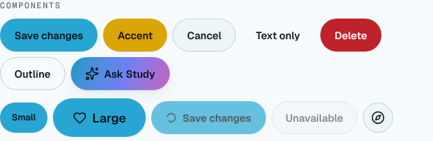
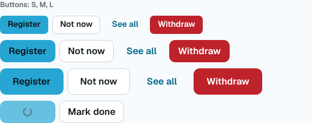
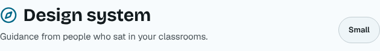
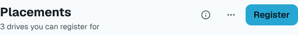
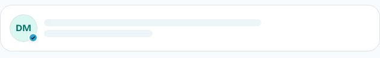
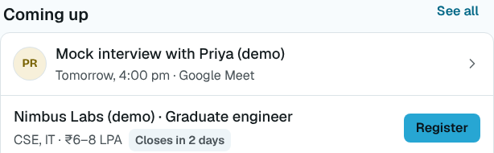
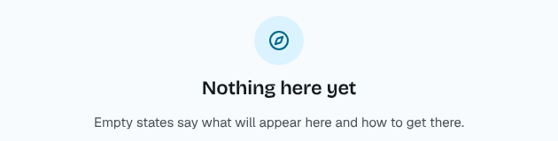
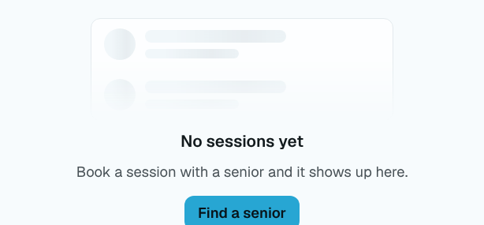
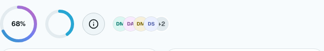
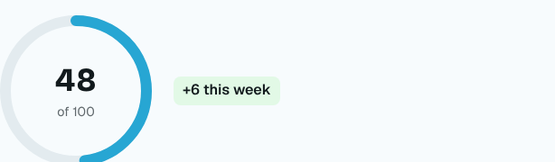

# ADR 0015: Design language v2: calm by default, six type steps, three radii, flat cards

- Status: accepted
- Date: 2026-11-07
- Supersedes: the visual parts of ADR 0008 (type scale, spacing, radii, elevation, surfaces, density, iconography, motion durations, component anatomy)

## Context

The conformance audit of 7 November 2026 (`docs/build/master-prompt-3.md` §3, findings A1–A19) found a product that is correct but reads as a college project: monospace letter-spaced eyebrows (A5), cards inside cards and uneven radii (A4), page headers that spend the first phone screen explaining the feature (A6), saturated primary buttons everywhere at the same weight (A7), and titles cut off with an ellipsis on most lists (A3). Prompt 3 (X2) asks for one design language, version 2, before any screen is rebuilt.

## Decision

### What ADR 0008 keeps

- Each college's hue generates the whole palette (`packages/shared/src/palette.ts`), and every `*-ink` token is contrast-checked to 5.5:1 (`palette.test.ts`).
- Bricolage Grotesque, Geist and Geist Mono, with Anek Telugu and Anek Devanagari in every stack, self-hosted and subset by `unicode-range`.
- `prefers-reduced-motion` and the member's own motion choice (`--motion-scale`).
- Celebrations only at the ADR 0008 moments, through `celebrate()`.
- Aurora only for the moments ADR 0008 lists, never for text or plain buttons.

### Tokens (`apps/web/src/styles/tokens.css`)

| Token                 | v2                                                                                                                    | Was (ADR 0008)                                    |
| --------------------- | --------------------------------------------------------------------------------------------------------------------- | ------------------------------------------------- |
| Type steps            | Display 32/36, Title 22/28, Headline 18/24, Body 16/24, Callout 14/20, Caption 12.5/16 (px at 360, +15% by 1280)      | Eight steps, caption 12 … hero 56; body 15        |
| Type faces            | Bricolage for Display and Title (screen titles, big numbers); Geist for everything else; Geist Mono for codes and IDs | Bricolage on every h1–h4; mono eyebrows and dates |
| Telugu and Devanagari | 2 px more line height on every step (`--lh-*`, tested in `tokens.test.ts`)                                            | Body line height 1.7, headings 1.3                |
| Section labels        | `eyebrow`: Caption, semibold, sentence case, UI face. `table-label` (tiny capitals) only for staff table headers      | Mono, 12 px, uppercase, 0.14 em tracking          |
| Space                 | 4 px base: 4 8 12 16 20 24 32 40 56 72. Gutters 16 / 24 / 32 (`--gutter`). Reading 680 px, content 1200 px            | 16 px gutter at every width                       |
| Radii                 | Three: 8 (inputs, chips, small buttons), 12 (cards, rows, M and L buttons), 20 (sheets, dialogs, hero media)          | 6, 10, 14, 20, 28; pill buttons                   |
| Surfaces              | One background, two raised (`surface-1`, `surface-2`), one sunken (`--sunken`, new). Dark is a true dark (bg L 0.145) | Dark bg L 0.16; no sunken surface                 |
| Elevation             | Shadows only on floating layers (`elev-2`…`elev-4`: menus, sheets, toasts). Cards are flat with a 1 px border         | `elev-1` under every card, lift on hover          |
| Colour                | Neutrals carry the UI; the hue marks the primary button, active navigation, links, progress, selection                | (unchanged generator; used more freely)           |
| Status colours        | Fixed hues, inks ≥ 5.5:1 on every college's surfaces (tested across the hue wheel and eight awkward college colours)  | Checked against the default hue only              |
| Iconography           | lucide at 20 px, 1.75 stroke (the icon factory's default), only where it adds meaning; no icons in tinted circles     | 2 stroke; icon in a tinted circle on most rows    |
| Motion                | Press 120 ms, enter 200 ms, sheet 280 ms; `--ease-standard`, `--ease-emphasised`; transform and opacity only          | 140 / 260 / 300 / 460 ms springs                  |
| Density               | `data-density="compact"`: 44 px rows for staff tables and lists (56 px otherwise; never under 44)                     | None                                              |

The old type names (`text-meta`, `text-lead`, `text-hero`) were renamed across the app in one codemod (meta → callout, lead → body, hero → display, title → headline, headline → title) and a lint rule now rejects them. The old radius names still work and map onto the three values (xs and sm → 8, md and lg → 12, xl → 20).

### Primitives (`apps/web/src/components/ui/`)

New: `ListRow` and `ListSection` (`list-row.tsx`), `Toolbar`, `OverflowMenu`, `ActionCard`, `PersonCard`, `Countdown`, `StepTrack`, `ScoreRing`, `Timeline`, `Kbd`, `SkeletonRow`, `SkeletonCard`, `SkeletonChart`, and `toast.undo()`.

Reworked: `Button` (S 36 / M 44 / L 52 with a 44 px hit area on S; primary, secondary, tertiary, danger; loading keeps the width), `PageHeader` (title, one-line subtitle, one primary action, overflow; the explanation goes behind "About this"; a compact title bar on phones once the title scrolls away), `EmptyState` (a faded preview of what will appear and one action; icons drawn plain), `Card` (flat; `interactive` answers with border and surface, not a shadow).

Rules for screens: one primary action per screen; a screen that styles a raw `
` into a card, row or toolbar is a defect; rows wrap their titles (no ellipsis on titles, names, companies or roles, X5); nothing at zero is shown at the same weight as something waiting.

Every primitive is in the style guide (`/design`, both themes, Telugu and Hindi rows, compact density) and in `primitives.a11y.test.tsx` (rendered in a router and checked by axe).

## Before and after

Captured from the living style guide (`/design`, DPIT, light, 1440 px): before at `094acfc`, after at this change. Files in `docs/design/v2/u1/`.

| Primitive   | Before                                      | After                                      |
| ----------- | ------------------------------------------- | ------------------------------------------ |
| Buttons     |      |      |
| Page header |  |  |
| List rows   |    |    |
| Empty state |  |  |
| Score ring  |   |   |

## Consequences

- Every screen changes a little at once (type sizes, radii, flat cards, sentence-case labels, buttons 44 px instead of 48). Screens are rebuilt onto the new primitives phase by phase (U2–U9); until then they mix old layouts with the new tokens.
- Body text is 16 px on phones (was 15), so some screens get longer; Telugu and Hindi gain 2 px per line.
- The status inks now hold 5.5:1 on any college's tinted surfaces, at the cost of slightly darker inks in light mode.
- The palette is generated by the API and sent with the tenant (`PublicTenant.palette`, prompt 3 U0), so the generator is no longer in the app's first load; the branding screen still previews locally.
