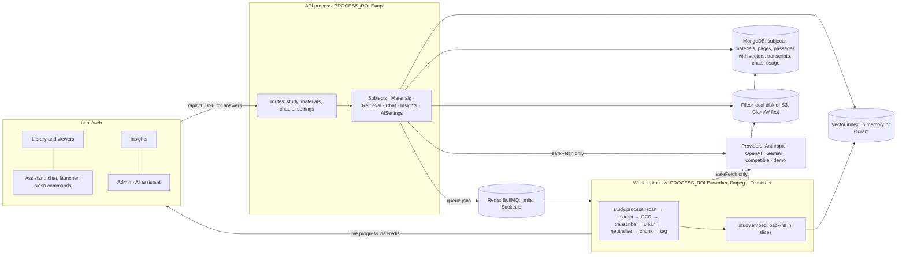
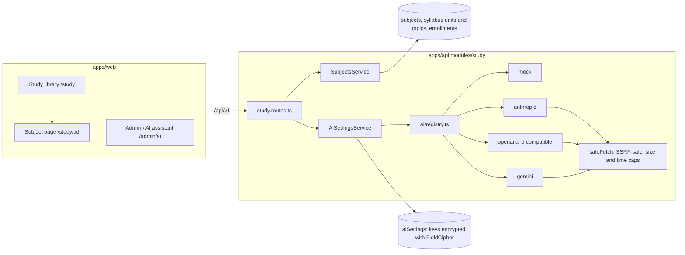
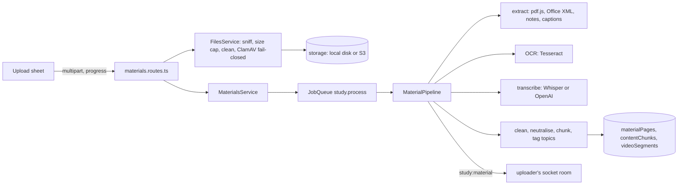
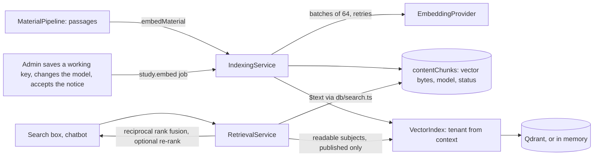
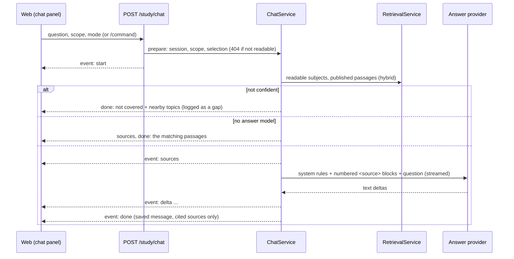

# AI study assistant

The subject library and the study chatbot (spec: `docs/specs/ai-study-assistant.md`). This document grows with each delivery step; it covers all **six steps**: subjects and syllabus, who takes a subject, the settings page, encrypted key storage and the provider adapters; material upload, the processing pipeline and the viewers; embeddings, the vector index and hybrid search; the study assistant with its slash commands; budgets, limits, degradation, faculty insights and the admin dashboard; and the hardening, the separate worker, the seeded demo and the performance check.

## What it is, in one paragraph

Faculty upload material per subject. The material is split into passages, and (when a provider is configured) each passage gets an embedding. When a student asks a question, the passages that best match it are retrieved and only those, with the question, are sent to the language model, which must answer from them and cite them. Nothing is trained or fine-tuned on a college's material. With no provider configured, everything except generated answers still works: the library, keyword search, and answers made of the matching passages.

## Try it with no key (the seeded demo)

`pnpm seed` creates, in each demo college, **Formal Languages and Automata Theory (DEMO)**: a five-unit syllabus, three short notes written for the demo, and a synthetic demo video (colour bars, no sound) whose transcript is a short self-written lesson, all labelled DEMO. The built-in demo assistant and demo embeddings are on, so everything works with no key and nothing leaves the machine:

1. Sign in as `ananya@dpit.example` (password in the seed output) and open **Study › Formal Languages and Automata Theory (DEMO)**.
2. Press **Ask** and ask "What does the pumping lemma show?": the answer cites _DEMO notes 2_; the citation opens the PDF at page 2 with the words highlighted.
3. Open **Study assistant** and type `/videos subset construction`: the demo lesson appears with links to its moments; a link opens the video at that moment with the transcript following along.
4. As `faculty@dpit.example`, open the subject's **Insights**; as `admin@dpit.example` (two-factor set-up on first sign-in), open **Admin › AI assistant** to attach a real provider.

## The whole system

- **Pipeline stages** (one `study.process` job per material version, resumable): `uploaded` → `scanning` (ClamAV, fails closed) → `extracting` (PDF text per page, DOCX, PPTX, notes) → `ocr` (scanned pages, Tesseract) → `transcribing` (uploaded captions, or Whisper or OpenAI when set up) → `chunking` (headers and footers removed, instruction-like text neutralised, passages within a page or between chapters, tagged to syllabus topics) → `embedding` → `indexed`, or `failed` with a reason the uploader sees and a **Process again** button.
- **Where things run:** the API answers requests and queues jobs; workers run the pipeline, embeddings, notifications and ingestion (`docs/deployment.md`). Without `PROCESS_ROLE` one process does both.

## Attaching an API key (college admin)

1. Sign in as a college admin (two-factor authentication is required for admins) and open **Admin › AI assistant** (`/admin/ai`).
2. **Choose a provider** under _Answer provider_: Anthropic (Claude), OpenAI, Google Gemini, or an OpenAI-compatible server (enter its public `https://…/v1` address). Choose **Demo (built in)** to try the flow with no key: it quotes your material and sends nothing anywhere. Press **Save settings**.
3. **Paste the key** in the _API key_ field that appears and press **Save and test**. The key is encrypted at once; the page then shows only its last four characters. The test makes one small request (the provider's model list) and shows _Working_ or the provider's reason for refusing it. Choose the answer model from the models the key can use (Anthropic defaults to `claude-opus-5-5`) and save.
4. **Semantic search (optional):** under _Semantic search_, choose an embedding provider and model. Anthropic has no embeddings API, so pair Claude answers with OpenAI, Gemini or a compatible server, or leave it off for keyword search. If the embedding provider is the same as the answer provider, the same key is used. Once a working key is saved (and the notice accepted), every passage already in the library gets its vector automatically; the _Search index_ panel shows the progress and the checklist ticks **Search index ready** when nothing is waiting.
5. **Accept the data notice** (_Data processing notice_): it states that passages of uploaded material and students' questions are sent to the chosen provider. The acceptance is versioned and written to the audit log. External providers stay off until it is accepted.
6. Turn on **Study chatbot** under _Switches_, check the limits (monthly token budget, questions per member per day, answer length, passages per answer, chat retention) and save. The status at the top reads **On**.
7. **Optional, for the cost estimate:** under _Limits_, enter your provider's prices per million tokens exactly as its pricing page lists them (input and output for answers, and embeddings), in the currency you pay in. The app never fills these in. **Usage and health** then shows an estimate for the period and the month.

To stop everything at once, turn on **Stop all AI now** (the kill switch): no request reaches any provider, and search and the library keep working. Removing a key, changing a provider, accepting the notice and every test are audit-logged; the key itself never appears in a response, a log or the audit log.

## Platform owner options (environment)

| Variable                                                                                                                       | Purpose                                                                                                                                                                                                                                         |
| ------------------------------------------------------------------------------------------------------------------------------ | ----------------------------------------------------------------------------------------------------------------------------------------------------------------------------------------------------------------------------------------------- |
| `AI_DEFAULT_PROVIDER`, `AI_DEFAULT_API_KEY`, `AI_DEFAULT_CHAT_MODEL`, `AI_DEFAULT_BASE_URL`                                    | An optional default for colleges that have not chosen a provider. A college's own choice overrides it. The key is the platform owner's and is never shown to colleges.                                                                          |
| `AI_DEFAULT_EMBEDDING_PROVIDER`, `AI_DEFAULT_EMBEDDING_API_KEY`, `AI_DEFAULT_EMBEDDING_MODEL`, `AI_DEFAULT_EMBEDDING_BASE_URL` | The same for embeddings.                                                                                                                                                                                                                        |
| `AI_PRIVATE_ENDPOINTS`                                                                                                         | Origins such as `http://ollama:11434` that colleges may use although they are private or plain http (a local Ollama or LM Studio). College admins can only enter public `https` addresses; every call still goes through the SSRF-safe fetcher. |

| Variable                       | Purpose                                                                                                                                                                                                            |
| ------------------------------ | ------------------------------------------------------------------------------------------------------------------------------------------------------------------------------------------------------------------ |
| `OCR_PROVIDER`                 | `auto` (default) reads scanned pages with Tesseract when it is installed (the production API image has it, with the Telugu pack); `tesseract` requires it; `none` turns OCR off. Colleges can also switch OCR off. |
| `OCR_LANGUAGES`                | Tesseract languages, such as `eng+tel` (install the Telugu language pack first).                                                                                                                                   |
| `MEDIA_TOOLS`                  | `auto` (default) uses `ffmpeg`, `ffprobe` and `pdftoppm` when installed: video length, a poster frame, the audio for transcription and page images for OCR. `none` turns them off.                                 |
| `WHISPER_URL`                  | A local Whisper service (the optional `whisper` Docker profile) for video and audio transcripts; nothing leaves the server. Without it, a college that uses OpenAI (with consent) can use it.                      |
| `VECTOR_STORE`                 | Where passage vectors are indexed: `auto` (default; Qdrant when `QDRANT_URL` is set, otherwise memory), `memory` or `qdrant`. Use Qdrant whenever more than one API server runs.                                   |
| `QDRANT_URL`, `QDRANT_API_KEY` | The Qdrant REST address (the optional `qdrant` Docker profile: `http://127.0.0.1:6333`) and its key, if it has one. Platform-owned, so it may be on the private network.                                           |
| `AI_RERANKER`                  | `none` (default) keeps the fused order; `llm` asks the college's answer model to re-order the passages it is about to use (better order, more tokens).                                                             |

A college still accepts the data notice and turns the chatbot on itself when it uses the platform default.

## Architecture (step 1)

- **Providers** implement `LLMProvider` (`generate`, `listModels`) and `EmbeddingProvider` (`embed`, `listModels`) in `apps/api/src/modules/study/ai/`. Each is one file and calls the provider's HTTP API through `safeFetch` (the repository rule for every server-side fetch), so redirects, private addresses, size and time are controlled in one place. Errors become a `ProviderError` with a short message from which the key, and anything key-shaped, is removed.
- **Anthropic** requests use API version `2026-10-21` (no sampling parameters: temperature is never sent), keep only the text blocks of the answer, report refusals, and on Claude 4.6 and later ask for `low` effort with room for thinking within the answer cap.
- **The mock provider** needs no key and makes no calls: deterministic embeddings (hashed words) and extractive answers with `[n]` citations from the supplied passages. It deliberately obeys an instruction that reaches it outside the delimited passages, so the injection tests can prove the prompt builder never lets material escape its delimiters.

## Material and processing (step 2)

- **What can be uploaded:** PDF (50 MB), Word and PowerPoint (`.docx`, `.pptx`, 50 MB), images, notes (`.md`, `.txt`), video and audio files (200 MB), YouTube and Vimeo links, and captions (`.vtt`, `.srt`, 2 MB) for any video. Files are sniffed by content, not by name; PDFs are re-saved, images re-encoded, video metadata stripped, and every file is scanned by ClamAV before it is stored (the upload fails if the scanner is down). Archives and executables are refused.
- **Who uploads:** faculty and admins publish at once; alumni contributors and (when the subject allows it) students go to the subject owners' review queue. Every uploader confirms they have the right to share the file; the attestation is stored with a timestamp. Owners and admins can take material down with a reason the uploader sees.
- **Processing** runs as one background job per material version (three attempts with exponential back-off, then marked failed with a reason). The stages are scanning, extracting, OCR, transcribing, chunking, embedding and indexed. The uploader watches the stages live and gets a notification when the material is ready or has failed. Anything that could not be done says what to do: "scanned pages need OCR, which is not set up", "upload captions so students can jump to topics".
- **Passages:** page headers, footers and page numbers are removed, hyphenated line ends rejoined, and instruction-like lines ("ignore previous instructions", "you are now…") replaced with a marker before the text is split into passages of about 500 tokens (never more than 800) at headings, with a small overlap inside a section. Each passage keeps its page or time range and is tagged with the syllabus topics it mentions. Video transcripts are split by time, chapters first.
- **Files are served through signed links** that last five minutes and re-check access on every request (owner decision Q9). The PDF viewer, the media player and downloads all use them; a link that lapses mid-video is re-signed and the video resumes where it was.
- **Video links** are shown behind a click-to-load facade: nothing is requested from YouTube or Vimeo until the student presses play, and then only through the privacy-enhanced embeds (`youtube-nocookie.com`, Vimeo with `dnt=1`), the only two frame origins added to the CSP. Their title and length come from oEmbed through `safeFetch`.
- **Keyword search** looks in the passages of published material in the subjects the member reads, through the passages' text index (`$text` via `db/search.ts`). A result opens the PDF at its page or the video at its moment, with the words highlighted.

## Embeddings, the vector index and hybrid search (step 3)

- **Embedding** happens as material is processed and, for everything already in the library, in a **back-fill** that starts the moment a working embedding provider appears (a key saved or tested, the notice accepted, the provider or model changed). One back-fill runs per college at a time (a lease on the college's settings); it works in two-minute slices and hands over to a fresh job. Each passage is embedded with its material's title and heading for context, 64 at a time.
- **Vectors are stored on the passages** (`contentChunks.vector`, float32 bytes, with the `provider:model` that made them). The vector store is an index over them: a lost or new index is rebuilt from MongoDB without paying the provider again (**Rebuild the index** in the admin panel, or automatically when the store holds fewer vectors than MongoDB). The in-memory store loads a college's vectors the first time they are needed after a restart.
- **A different model means re-indexing, never mixing:** searches only compare vectors of the current `provider:model`, the back-fill re-embeds passages made by another model, and the old model's vectors are removed from the index.
- **Failures never block material.** A passage the provider refuses (too long, unreadable) is marked and stays keyword-searchable; the rest of its batch is embedded (a refused batch is split until the passage is found, after a one-word probe proves the model itself works). An outage or rate limit retries with back-off and then tries again ten minutes later; a revoked key is marked invalid for the admin and members fall back to keyword search. Nothing is lost: waiting passages catch up when the provider is back.
- **Topics by meaning:** when embeddings are on, a passage is also tagged to the syllabus topic whose title and keywords are closest in meaning (cosine similarity at least 0.5), in addition to the keyword tags.
- **Hybrid retrieval** (`RetrievalService.retrieve`): the passages closest in meaning (the vector index) and the best keyword matches (the text index) are merged with reciprocal rank fusion (k = 60), optionally re-ranked, and every passage is re-read from MongoDB with the same rules (readable subject, published, unit and topic filters) before it is returned, so a stale vector can never leak a passage. Retrieval reports `confident` when the best similarity reaches 0.3 or the top passages contain at least 60% of the question's content words; the chatbot (step 4) will answer only then. The search box drops passages found only by meaning below 0.3 similarity and marks the rest **Similar meaning**.
- **Isolation:** callers never pass a college. `VectorIndex` takes the tenant from the request or job context (and throws outside one), every store refuses a search or write without a tenant, the readable subjects and a model, and Qdrant points carry the tenant in a tenant-partitioned index. The contract tests run against both stores (`test/vector-store.test.ts`; Qdrant in CI).
- **Usage:** every embedding request is counted per college, member (null for background work), day and model (`aiUsage`), for the budgets and dashboard of step 5. A search by meaning embeds the question and counts against the member.

### Switching the vector store

1. Start Qdrant (`docker compose --profile qdrant up -d qdrant`, or a managed Qdrant) and set `QDRANT_URL` (and `QDRANT_API_KEY` if it has one). `VECTOR_STORE=auto` picks it up; `VECTOR_STORE=qdrant` makes it required (the API will not start without `QDRANT_URL`).
2. Restart the API, then press **Rebuild the index** in each college's _Search index_ panel (or wait for the next back-fill): the stored vectors are copied in; nothing is re-embedded.
3. Another engine (pgvector, MongoDB Atlas Vector Search) is one class implementing `VectorStore` (`modules/study/vector/`); `atlas.ts` is a documented starting point. It must pass the same contract tests.

### Cost-control tips

- Embeddings are cheap next to answers: a 100-page PDF is roughly 50,000 tokens, embedded once. Changing the embedding model re-embeds the whole library, so choose it before uploading a lot.
- Keep `AI_RERANKER=none` unless answers cite the wrong passages: re-ranking sends the candidate passages to the answer model on every question.
- **Rebuild the index** never calls the provider; prefer it to changing models when the index looks wrong.
- Lower _Passages per answer_ before lowering the answer length: passages are most of each question's input tokens.
- Set a **monthly token budget** before turning the chatbot on for everyone, and a modest **questions per member per day**; the admins are told at 80% of the budget, and members fall back to passages rather than errors when either runs out.
- Enter the provider's prices to see the estimate; check _Usage by model_ for what dominates (usually answers, not embeddings).

## Budgets, limits, degradation and insights (step 5)

### What happens when something runs out or breaks

| Situation                                                                                                             | What members see                                                                                                       | What admins see                                                                                                                                                                                                               |
| --------------------------------------------------------------------------------------------------------------------- | ---------------------------------------------------------------------------------------------------------------------- | ----------------------------------------------------------------------------------------------------------------------------------------------------------------------------------------------------------------------------- |
| No provider or key                                                                                                    | Library, keyword search, `/videos`, `/notes`, `/syllabus`; answers are the matching passages                           | The checklist and status say what is missing                                                                                                                                                                                  |
| The **monthly token budget** is used (UTC month, every kind of usage counts)                                          | Answers become passages ("this month's AI answers are used up"); search is keyword-only; generative commands say why   | A notification at 80% and at 100%, once each per month; the budget meter turns amber, then red. Embedding of new material waits for the 1st (a back-fill is scheduled for then), or resumes at once when the budget is raised |
| A member reached **questions per member per day** (model answers on the UTC day; `/videos` and `/notes` do not count) | Their questions get passages and generative commands say "You've used today's AI answers"; everyone else is unaffected | –                                                                                                                                                                                                                             |
| The provider has an outage, a rate limit or a time-out                                                                | One retry if nothing was shown yet; then the passages ("the AI could not be reached just now")                         | _Last provider problem_ on the dashboard; the failed answers count                                                                                                                                                            |
| Repeated outages (5 in a row)                                                                                         | Passages at once for a minute (no waiting for time-outs), then one try                                                 | _Answers are paused until …_ on the dashboard                                                                                                                                                                                 |
| The provider rejects the key while answering or embedding                                                             | Passages (reason: key rejected)                                                                                        | The key turns **Rejected**; a notification once; paste a new key or press **Test**                                                                                                                                            |
| The kill switch                                                                                                       | Library and keyword search only                                                                                        | –                                                                                                                                                                                                                             |

The circuit breaker (`modules/study/ai/breaker.ts`) is per college and endpoint, on each API server; only outages count, never a rejected key or a refused request, and a member pressing Stop is not a failure. The retry happens only before any text reached the member (a retry after that would repeat what they already read).

### Faculty insights (`/study/:id/insights`)

For the subject's owners and the college's admins (`study:analytics`; other faculty get 403). Everything is an aggregate: counts under 5 show as "<5" (`suppress()`), the helpful rate appears only with 5 ratings or more, and no question text, conversation or member is returned.

- **Most asked topics:** questions per syllabus topic, from the topics of the passages each answer used (or, for questions the material did not cover, the topics they were near).
- **Content gaps:** topics that uncovered questions were near, and words that at least 5 different students asked about and that match no topic (counted by stem, shown in the form asked most often). **Upload material for this** opens the subject's upload sheet with the topic already chosen.
- **Most used material:** how many answers cited each material, and how often it was opened (an anonymous daily counter, `materialViewStats`, with no member id; staff previews do not count).
- **Engagement by unit:** questions, distinct students and openings per unit.

### Admin dashboard (Admin › AI assistant › Usage and health)

The month against the budget (with when it starts again), tokens per day (a column chart with a table view), usage by model with the estimate from the admin's prices (the demo is free; transcription is priced per minute, so it has no estimate), answers, failed answers and questions the material did not cover, the last provider problem, whether answers are paused, the processing queue (in progress, failed, the oldest waiting) and, per subject, how much material is ready and how much is searchable by meaning. College totals only: there is no per-member view of usage.

## Hardening (step 6)

- **Injection suite** (`test/study-injection.test.ts`): hostile PDFs (instructions, closing our tags, file names that try to break out of the title attribute), a hostile transcript, a hostile "Ask about this" selection, hostile syllabus titles for `/important`, and follow-ups after answers that quoted hostile text. The demo responder obeys any instruction that reaches it outside a `<source>` block; a positive control shows the trap works, and every case shows nothing reached it, no other subject's words appeared and the prompt was never revealed. Found and fixed on the way: `</sources>` (plural) was not neutralised at ingestion, and earlier answers and syllabus titles reached the model outside the sources without being neutralised.
- **Isolation suite** (`test/isolation/study.test.ts`): across colleges for every collection and endpoint, and inside a college for a subject a student does not take: subject, syllabus, materials, files, signed links, search, chat scope, ask-about-this, `/videos`, `/notes` and insights. The vector store contract runs against the in-memory store and Qdrant.
- **Performance** (`pnpm --filter @campuslink/api study:perf`, `docs/performance.md`): 50,000 passages, hybrid retrieval p95 153 ms (target 300), first streamed words under 260 ms with the demo responder (target 1.5 s). Keyword and vector search now run concurrently, and the keyword half has a 200 ms limit when search by meaning can answer instead.

## The study assistant (step 4)

- **One request per question:** `POST /api/v1/study/chat` answers with server-sent events (`start`, `sources`, `delta`, `replace`, `done`, `error`). Access, validation and limits are checked before the stream starts, so those failures are ordinary JSON errors. The web client reads the stream with `fetch` (`lib/chat-stream.ts`); Stop aborts it, the server stops the provider and saves what was written.
- **Providers stream:** Anthropic (Messages API events, text deltas only, never thinking), OpenAI and compatible servers (`stream_options.include_usage`), and Gemini (`streamGenerateContent?alt=sse`) all stream through `safeFetch`, which now hands each piece of the body over as it arrives. The demo responder streams word by word.
- **The prompt** (`modules/study/chat/prompt.ts`) answers only from numbered `<source>` blocks, cites `[n]`, matches the student's language and the answer mode, and treats everything in a source as data. Material and questions cannot open or close our tags; emails, phone numbers and roll-number-like codes are removed from questions; nothing about the member is sent. Up to three earlier turns go with a question (without their old citation numbers); a short follow-up ("why?") borrows the previous question's words for retrieval, with no extra model call.
- **Grounding:** retrieval must be confident (section on step 3) or the model must cite; otherwise the answer is "not covered" with nearby syllabus topics, and the question (without personal details) is logged in `unansweredQuestions` for the faculty's content gaps (step 5 shows them as suppressed aggregates).
- **Commands:** see the table below. Commands that need a model show "AI is not enabled for your college yet" without one; the others always work.

| Command                                 | What it does                                                                                                                                                     | Needs the answer model |
| --------------------------------------- | ---------------------------------------------------------------------------------------------------------------------------------------------------------------- | ---------------------- |
| `/videos <topic>`                       | Every video the member may watch on the topic, "Exact topic" first, with the best moments as links; "From the web" YouTube links when the college turned them on | No                     |
| `/notes <topic>`                        | Notes, slides and PDFs on the topic, with the pages that cover it                                                                                                | No                     |
| `/summary <topic>`                      | A short, sectioned summary with sources                                                                                                                          | Yes                    |
| `/explain <topic> [easy\|medium\|hard]` | A step-by-step explanation with an example                                                                                                                       | Yes                    |
| `/quiz <topic> [n]`                     | 3 to 10 questions from the material only; scored on the server once, points through the `study_quiz` rule                                                        | Yes                    |
| `/flashcards <topic>`                   | Flip cards; **Keep as a deck** saves them                                                                                                                        | Yes                    |
| `/important <unit>`                     | What a unit's material covers most, labelled as derived from the material (not an exam prediction)                                                               | Yes                    |
| `/syllabus`, `/subject <name>`, `/help` | The syllabus to jump from, the answer scope, every command (in the browser)                                                                                      | No                     |

- **Conversations** (`chatSessions`, `chatMessages`) are the member's only: nobody else can open them, faculty included. They expire after the college's _Chat retention_ days (0 keeps them), and members delete one or all of them. Answers are stored as text exactly as written (ADR 0007 addendum) and rendered with the answer markdown subset; maths uses KaTeX, loaded only when an answer has maths.

### Adding a provider

1. Add its id to `AI_PROVIDERS` (and `EMBEDDING_PROVIDERS` if it embeds) in `packages/shared/src/constants/study.ts`, with a default model only if you are certain of it.
2. Write `apps/api/src/modules/study/ai/<name>.ts` implementing the interfaces, using `callJson` (it maps statuses, redacts keys and goes through `safeFetch`).
3. Add one line to `ai/registry.ts`, the labels in `en.json` and `te.json` (`ai.providers.<id>`), and adapter tests in `apps/api/test/ai-providers.test.ts`.

## Access rules

| Who                | Library and chatbot                                        | Subjects and syllabus            | Material                                       | AI settings                                                     |
| ------------------ | ---------------------------------------------------------- | -------------------------------- | ---------------------------------------------- | --------------------------------------------------------------- |
| Student            | Subjects they take (branch and batch rule, plus overrides) | Read                             | Read published                                 | –                                                               |
| Alumni             | Every subject                                              | Read                             | Upload to subjects an admin granted (reviewed) | –                                                               |
| Faculty, placement | Every subject                                              | Create; manage the ones they own | Upload, edit, delete                           | –                                                               |
| College admin      | Every subject                                              | Manage all; grant contributors   | Upload, edit, delete                           | Configure                                                       |
| Platform owner     | –                                                          | –                                | –                                              | Environment default only; never reads a college's keys or chats |

A subject a student may not read answers 404, exactly like one that does not exist.
