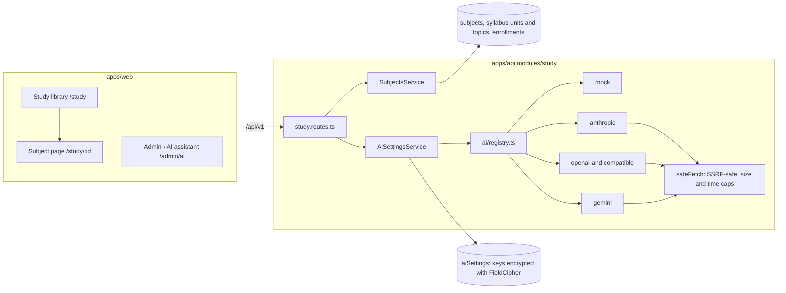

# AI study assistant

The subject library and the study chatbot (spec: `docs/specs/ai-study-assistant.md`). This document grows with each delivery step; it currently covers **step 1**: subjects and syllabus, who takes a subject, the settings page, encrypted key storage and the provider adapters.

## What it is, in one paragraph

Faculty upload material per subject. The material is split into passages, and (when a provider is configured) each passage gets an embedding. When a student asks a question, the passages that best match it are retrieved and only those, with the question, are sent to the language model, which must answer from them and cite them. Nothing is trained or fine-tuned on a college's material. With no provider configured, everything except generated answers still works: the library, keyword search, and answers made of the matching passages.

## Attaching an API key (college admin)

1. Sign in as a college admin (two-factor authentication is required for admins) and open **Admin › AI assistant** (`/admin/ai`).
2. **Choose a provider** under _Answer provider_: Anthropic (Claude), OpenAI, Google Gemini, or an OpenAI-compatible server (enter its public `https://…/v1` address). Choose **Demo (built in)** to try the flow with no key: it quotes your material and sends nothing anywhere. Press **Save settings**.
3. **Paste the key** in the _API key_ field that appears and press **Save and test**. The key is encrypted at once; the page then shows only its last four characters. The test makes one small request (the provider's model list) and shows _Working_ or the provider's reason for refusing it. Choose the answer model from the models the key can use (Anthropic defaults to `claude-opus-5-5`) and save.
4. **Semantic search (optional):** under _Semantic search_, choose an embedding provider and model. Anthropic has no embeddings API, so pair Claude answers with OpenAI, Gemini or a compatible server, or leave it off for keyword search. If the embedding provider is the same as the answer provider, the same key is used.
5. **Accept the data notice** (_Data processing notice_): it states that passages of uploaded material and students' questions are sent to the chosen provider. The acceptance is versioned and written to the audit log. External providers stay off until it is accepted.
6. Turn on **Study chatbot** under _Switches_, check the limits (monthly token budget, questions per member per day, answer length, passages per answer, chat retention) and save. The status at the top reads **On**.

To stop everything at once, turn on **Stop all AI now** (the kill switch): no request reaches any provider, and search and the library keep working. Removing a key, changing a provider, accepting the notice and every test are audit-logged; the key itself never appears in a response, a log or the audit log.

## Platform owner options (environment)

| Variable                                                                                                                       | Purpose                                                                                                                                                                                                                                         |
| ------------------------------------------------------------------------------------------------------------------------------ | ----------------------------------------------------------------------------------------------------------------------------------------------------------------------------------------------------------------------------------------------- |
| `AI_DEFAULT_PROVIDER`, `AI_DEFAULT_API_KEY`, `AI_DEFAULT_CHAT_MODEL`, `AI_DEFAULT_BASE_URL`                                    | An optional default for colleges that have not chosen a provider. A college's own choice overrides it. The key is the platform owner's and is never shown to colleges.                                                                          |
| `AI_DEFAULT_EMBEDDING_PROVIDER`, `AI_DEFAULT_EMBEDDING_API_KEY`, `AI_DEFAULT_EMBEDDING_MODEL`, `AI_DEFAULT_EMBEDDING_BASE_URL` | The same for embeddings.                                                                                                                                                                                                                        |
| `AI_PRIVATE_ENDPOINTS`                                                                                                         | Origins such as `http://ollama:11434` that colleges may use although they are private or plain http (a local Ollama or LM Studio). College admins can only enter public `https` addresses; every call still goes through the SSRF-safe fetcher. |

A college still accepts the data notice and turns the chatbot on itself when it uses the platform default.

## Architecture (step 1)

- **Providers** implement `LLMProvider` (`generate`, `listModels`) and `EmbeddingProvider` (`embed`, `listModels`) in `apps/api/src/modules/study/ai/`. Each is one file and calls the provider's HTTP API through `safeFetch` (the repository rule for every server-side fetch), so redirects, private addresses, size and time are controlled in one place. Errors become a `ProviderError` with a short message from which the key, and anything key-shaped, is removed.
- **Anthropic** requests use API version `2026-10-21` (no sampling parameters: temperature is never sent), keep only the text blocks of the answer, report refusals, and on Claude 4.6 and later ask for `low` effort with room for thinking within the answer cap.
- **The mock provider** needs no key and makes no calls: deterministic embeddings (hashed words) and extractive answers with `[n]` citations from the supplied passages. It deliberately obeys an instruction that reaches it outside the delimited passages, so the injection tests can prove the prompt builder never lets material escape its delimiters.

### Adding a provider

1. Add its id to `AI_PROVIDERS` (and `EMBEDDING_PROVIDERS` if it embeds) in `packages/shared/src/constants/study.ts`, with a default model only if you are certain of it.
2. Write `apps/api/src/modules/study/ai/<name>.ts` implementing the interfaces, using `callJson` (it maps statuses, redacts keys and goes through `safeFetch`).
3. Add one line to `ai/registry.ts`, the labels in `en.json` and `te.json` (`ai.providers.<id>`), and adapter tests in `apps/api/test/ai-providers.test.ts`.

## Access rules

| Who                | Library and chatbot                                        | Subjects and syllabus            | Material                                       | AI settings                                                     |
| ------------------ | ---------------------------------------------------------- | -------------------------------- | ---------------------------------------------- | --------------------------------------------------------------- |
| Student            | Subjects they take (branch and batch rule, plus overrides) | Read                             | Read published                                 | –                                                               |
| Alumni             | Every subject                                              | Read                             | Upload to subjects an admin granted (reviewed) | –                                                               |
| Faculty, placement | Every subject                                              | Create; manage the ones they own | Upload, edit, delete                           | –                                                               |
| College admin      | Every subject                                              | Manage all; grant contributors   | Upload, edit, delete                           | Configure                                                       |
| Platform owner     | –                                                          | –                                | –                                              | Environment default only; never reads a college's keys or chats |

A subject a student may not read answers 404, exactly like one that does not exist.
