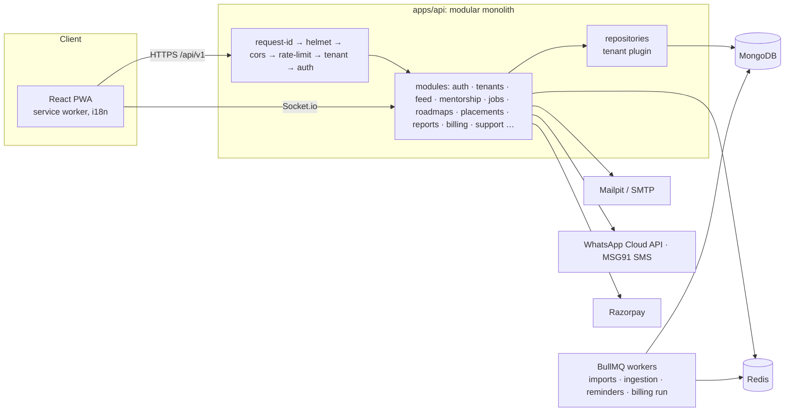

# Architecture

Grows with each phase (now through master prompt 1, builds B1 to B15).

## Request pipeline

`rate limit → tenant scope → feature switch (B1) → read-only (writes, B10) → CSRF (cookie routes) → authenticate → authorize → bot check (where declared) → upload (where declared) → validate (Zod) → idempotency (where declared) → handler → service` (ADR 0006: authorization before validation). Route specs live in `modules/<name>/<name>.routes.ts` and feed OpenAPI, `docs/permissions.md` and the permission test.

## Realtime

Socket.io at `/api/v1/realtime` (`http/realtime.ts`), with the Redis adapter for multiple instances.

- **Handshake:** access token in `auth.token`, tenant from the `Host` header, the same live checks as HTTP (`authFromToken`), `Origin` allowlist. The socket closes when the token expires; the client refreshes and reconnects.
- **Rooms:** one per user, named `u:<tenantId>:<userId>`.
- **Direction:** clients send only `typing`. Everything else (`message:new`, `message:read`, `notification:new`) is emitted by services after an authorised REST write.

## Background jobs

`JobQueue` (BullMQ; inline in unit tests). Jobs carry their tenant and run inside `runInTenant`. Jobs: feed and job-source fetches (`content.fetch`, `jobs.fetch`), job alerts (`jobs.alert`) and imports; referral expiry (`referrals.expire`) is delayed. Delayed jobs: booking reminders (24 h, 1 h), booking completion, request expiry and notification delivery after quiet hours. Delayed jobs carry the booking's `version` and do nothing when a reschedule made them stale; reads also settle overdue state, in case Redis lost a job.

## Feed and content

- **Modules:** `feed` (posts, comments, reactions, saves, polls, stories, follows, One Useful Thing, ranking), `qa`, `content-sources` (RSS/Atom ingestion) and `moderation` (reports, removals, appeals, queue).
- **Moderation framework:** content modules register a `ModeratableHandler` (`load`, `setRemoved`) with `ModerationService`. Moderation never touches another module's models.
- **Ranking:** `docs/feed-ranking.md`. **Ingestion:** `docs/content-sources.md`. **Rich text:** ADR 0007.
- **Scheduler:** every 60 s the API enqueues due source fetches (`content.fetch`, deduplicated by job id) under the named platform path `content:due-sources`; the jobs run per tenant.

## Jobs and referrals

- **Modules:** `jobs` (listings, Job Radar, tracker, alerts), `job-sources` (adapters, scheduler, health) and `referrals`.
- **Links between modules:**
  - `JobsService` gets referrer counts and source names through callbacks set in `app.ts`, so no module reads another's models.
  - Ingested postings are written by `JobsService.ingest()`.
- **Schedulers:** the 60-second ingestion tick also queues due job-source fetches (`jobs.fetch`, platform path `jobs:due-sources`) and due alerts (`jobs.alert`, platform path `jobs:due-alerts`).
- **Background permissions:** alert runs use `backgroundAuth()` (users module), so the member's current permissions and blocks apply.
- See `docs/job-sources.md`.

## Roadmaps

- **Module:** `roadmaps` (roadmaps, versions, review, progress, comments, library).
- **Library:** researched JSON in `modules/roadmaps/library/`, validated at load by `roadmapContent`. It is installed into each new college through `PlatformService.onTenantCreated` and by the seed. Library updates arrive as submitted versions that any reviewer can approve (`docs/roadmap-sources.md`).
- **Nudges:** every 5 minutes the API queues due weekly goal checks (`roadmaps.nudge`, platform path `roadmaps:due-nudges`). Each check runs with the member's current permissions (`backgroundAuth`).
- **Web:** the Career Galaxy and the roadmap graph are plain SVG (no WebGL). The layout is deterministic (`lib/roadmaps.ts`). The list view is the default with reduced motion and on small screens.

## Gamification, events and analytics

- **Modules:** `gamification` (ledger, badges, opt-ins, rewards), `events` (RSVP, reminders, ICS, Q&A) and `analytics`.
- **Awards:** other modules hold an `award` callback (`lib/awards.ts`), wired to `GamificationService.award` in `app.ts`. They never touch the ledger, and an award never fails the action that earned it.
- **Analytics:** `AnalyticsService` composes aggregate methods that each module's service exposes (`AnalyticsSources`), caches per college for 5 minutes and suppresses small counts.
- **Reminders:** delayed `events.reminder` jobs carry the event version.

## Privacy rights

- **Module:** `privacy` holds the export and deletion routes and the grace-period purge.
- **Hooks:** every module that holds personal data registers an exporter and an eraser with `PrivacyService.register()` in `app.ts`. The privacy module never reads another module's models.
- **Erasure:**
  - private data is deleted;
  - shared content is detached and shows as "Former member";
  - message bodies the member sent are blanked;
  - consent records and the audit log are kept, keyed by id only.
- **Schedule:** the daily retention run calls `purgeDue()` in each college.

## Master prompt 1 (builds B1 to B14)

- **Feature switches (B1):** `packages/shared/src/features.ts`; a route declares `feature` (or its module is wrapped in `withFeature`) and answers `403 FEATURE_DISABLED`; jobs go through `gatedJob` and no-op when the switch is off. Since B10 a switch is the plan ∧ the college's choice, resolved in the tenant cache. Data migrations run once per database at boot (`db/migrations.ts`, the `Migration` record is the lock).
- **Phone-first identity and minors (B2, ADR 0010):** one `OtpService` for every code (hashed, 10 minutes, 5 attempts, daily caps per member and per number, the `otp` IP limiter); `OtpSender` tries WhatsApp, then SMS. Minors are `guardian_pending` with no permissions until the guardian's code, sent to the number on the college's record, is confirmed; an hourly tick (`auth.adulthood`) clears `adultOn` at 18.
- **Channels (B3, ADR 0011):** `ChannelService` meters every WhatsApp and SMS message (`ChannelMessage`, `ChannelUsage`), applies the member's weekly cap and the college's monthly allowance (from the plan), falls back to push and email, and signs quick-reply actions. The webhook (`/webhooks/whatsapp`) lives on the platform host, checks Meta's signature over the raw body and is deduplicated in `WebhookReceipt`.
- **Onboarding (B4, B6):** `OnboardingService` issues invite links (hashed tokens) and class join codes; both end with a code to the contact on the college's record. The TPO console adds bulk verification, class progress (through `suppress()`) and targeted, pinned announcements.
- **Mentorship loop (B5):** delayed `mentorship.nudge` (24 h) and `mentorship.rematch` (48 h) jobs carry the request `version`; mentor stats are cached an hour.
- **Placements and reports (B7, B8):** module `placements` (companies, drives, registrations, offers, academic records, outcomes) and module `reports` (seven versioned definitions with a `compute` through `suppress()` and an audited student-level `evidence`). Drive reminders are delayed jobs carrying the drive `version`. The unique index on registrations makes a burst of taps register each student once (B15 load test: 500 at once).
- **Product analytics (B9):** services call a `track` callback after confirmed writes; `InsightsService` computes aggregates only; the platform's cross-college view runs through `withPlatformScope('insights:platform-aggregates', …)` and is audited.
- **Plans and billing (B10, ADR 0013):** plan terms from `PLANS` ← `PlanSetting` ← the college's deal (`mergeTerms()`); limits from `EntitlementsService`; invoices numbered on issue from `InvoiceCounter`; payments through `BillingService` (bank transfers by the platform, Razorpay Payment Links with an HMAC-checked webhook). A daily billing run per college marks overdue invoices, sends reminders and sets read-only from 30 days overdue; read-only refuses writes in the pipeline except an allowlist, and nothing is deleted.
- **AI cost (B11, ADR 0009):** answers default to the Haiku tier; the platform's provider is metered against the plan's allowance in `AiSettingsService.runtime()`.
- **Languages (B12):** `SUPPORTED_LOCALES` (en, te, hi) drives schemas, enums, formatters, pickers and the parity test; adding a language is `docs/adding-a-language.md`.
- **Offline (B13):** the web app keeps the member's own reads in IndexedDB (`lib/offline-cache.ts`, its own chunk), wipes them on sign-out, and replays three idempotent PUTs from an outbox. Image variants for data saver come from `GET /files/:id?w=`.
- **Help, legal and observability (B14):** `SupportService` (college desk and platform desk), `LegalService` (templates filled with the college's details; a published version asks members to accept again), `ErrorReporter` (disabled, console, Sentry envelope over `safeFetch`) for API errors, failed jobs and browser reports, and `GET /metrics` (platform host, bearer token) with counters labelled by route pattern, job, channel or status only.

## Production

- **Images:**
  - `deploy/api.Dockerfile`: the compiled API, run as non-root, with a health check;
  - `deploy/web.Dockerfile`: the Vite build behind nginx.
- **Headers:** the web security headers live in `deploy/nginx/security-headers.conf`. `vite preview` serves the same file, so the end-to-end suite runs under the production CSP.
- **Topology:** AWS Mumbai (`ap-south-1`) with Hyderabad (`ap-south-2`) for disaster recovery. See `docs/deployment.md`, `docs/runbook.md` and `docs/performance.md`.

## Swappable providers

| Interface           | Local                                          | Others                                                           |
| ------------------- | ---------------------------------------------- | ---------------------------------------------------------------- |
| `StorageProvider`   | local disk                                     | S3 (SSE-KMS) and S3-compatible stores (`lib/s3-storage.ts`)      |
| `MailProvider`      | SMTP → Mailpit                                 | any SMTP                                                         |
| `SmsProvider`       | disabled, console (dev outbox)                 | MSG91 Flow API with DLT templates (`lib/sms.ts`)                 |
| `WhatsAppProvider`  | disabled, console (dev outbox)                 | Meta Cloud API (`lib/whatsapp.ts`)                               |
| `PaymentProvider`   | disabled, stub (refused in production)         | Razorpay Payment Links (`lib/payments.ts`)                       |
| `ErrorReporter`     | disabled, console                              | Sentry or GlitchTip through the envelope protocol                |
| `LLMProvider`       | none until configured                          | Anthropic and others (`modules/study/ai/`)                       |
| `VideoProvider`     | Jitsi (`meet.jit.si`, link-out)                | self-hosted Jitsi + JWT, 100ms and Daily stubs (`docs/video.md`) |
| `BotProtection`     | disabled                                       | Turnstile (server check plus the web widget, `lib/bot-check.ts`) |
| `MalwareScanner`    | skipped (never "clean")                        | ClamAV `clamd`, fail closed (`lib/clamav.ts`)                    |
| `PushSender`        | web push (VAPID) when keys set                 | —                                                                |
| `DataSourceAdapter` | CSV, XLSX, Google Sheets, REST                 | ERP adapters (`docs/data-sources.md`)                            |
| `JobSourceAdapter`  | Greenhouse, Lever, Ashby, SmartRecruiters, RSS | Adzuna with deployment keys (`docs/job-sources.md`)              |

## Phases

0 Foundation · 1 Secure core · 2 People · 3 Mentorship · 4 Feed and content · 5 Jobs and referrals · 6 Roadmaps and Career Galaxy · 7 Gamification, events, analytics · 8 Hardening and launch · 9 Study and the AI assistant · 10 to 13 the revamp · master prompt 1 (B1 to B15): feature switches, phone identity and minors, WhatsApp and SMS, invites, the mentorship loop, the TPO console, placement drives, outcomes and accreditation reports, product analytics, plans and billing, AI cost, Hindi, offline, help and legal, hardening. The record of each build is `docs/build/progress.md`; the summary is `docs/build/report-1.md`.

See `docs/adr/` for decisions.
