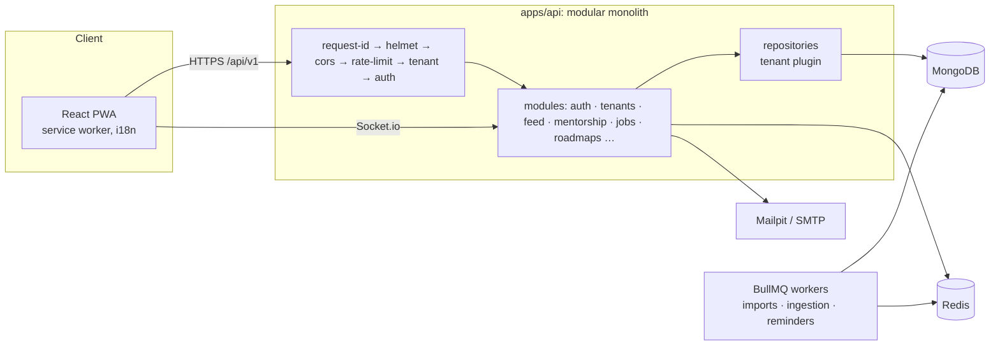

# Architecture

Grows with each phase (now through Phase 3).

## Request pipeline

`rate limit → tenant scope → CSRF (cookie routes) → authenticate → authorize → bot check (where declared) → upload (where declared) → validate (Zod) → idempotency (where declared) → handler → service` (ADR 0006: authorization before validation). Route specs live in `modules/<name>/<name>.routes.ts` and feed OpenAPI, `docs/permissions.md` and the permission test.

## Realtime

Socket.io at `/api/v1/realtime` (`http/realtime.ts`), with the Redis adapter for multiple instances.

- **Handshake:** access token in `auth.token`, tenant from the `Host` header, the same live checks as HTTP (`authFromToken`), `Origin` allowlist. The socket closes when the token expires; the client refreshes and reconnects.
- **Rooms:** one per user, named `u:<tenantId>:<userId>`.
- **Direction:** clients send only `typing`. Everything else (`message:new`, `message:read`, `notification:new`) is emitted by services after an authorised REST write.

## Background jobs

`JobQueue` (BullMQ; inline in unit tests). Jobs carry their tenant and run inside `runInTenant`. Delayed jobs: booking reminders (24 h, 1 h), booking completion, request expiry and notification delivery after quiet hours. Delayed jobs carry the booking's `version` and do nothing when a reschedule made them stale; reads also settle overdue state, in case Redis lost a job.

## Swappable providers

| Interface           | Local                           | Others                                                           |
| ------------------- | ------------------------------- | ---------------------------------------------------------------- |
| `StorageProvider`   | local disk                      | S3 stub                                                          |
| `MailProvider`      | SMTP → Mailpit                  | any SMTP                                                         |
| `SmsProvider`       | disabled                        | (deployment adapter)                                             |
| `VideoProvider`     | Jitsi (`meet.jit.si`, link-out) | self-hosted Jitsi + JWT, 100ms and Daily stubs (`docs/video.md`) |
| `BotProtection`     | disabled                        | Turnstile                                                        |
| `PushSender`        | web push (VAPID) when keys set  | —                                                                |
| `DataSourceAdapter` | CSV, XLSX, Google Sheets, REST  | ERP adapters (`docs/data-sources.md`)                            |

## Phases

0 Foundation · 1 Secure core · 2 People · 3 Mentorship · 4 Feed and content · 5 Jobs and referrals · 6 Roadmaps and Career Galaxy · 7 Gamification, events, analytics · 8 Hardening and launch.

See `docs/adr/` for decisions.
