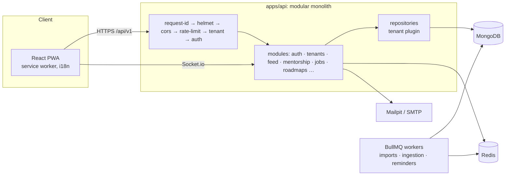

# Architecture

Grows with each phase (now through Phase 5).

## Request pipeline

`rate limit → tenant scope → CSRF (cookie routes) → authenticate → authorize → bot check (where declared) → upload (where declared) → validate (Zod) → idempotency (where declared) → handler → service` (ADR 0006: authorization before validation). Route specs live in `modules/<name>/<name>.routes.ts` and feed OpenAPI, `docs/permissions.md` and the permission test.

## Realtime

Socket.io at `/api/v1/realtime` (`http/realtime.ts`), with the Redis adapter for multiple instances.

- **Handshake:** access token in `auth.token`, tenant from the `Host` header, the same live checks as HTTP (`authFromToken`), `Origin` allowlist. The socket closes when the token expires; the client refreshes and reconnects.
- **Rooms:** one per user, named `u:<tenantId>:<userId>`.
- **Direction:** clients send only `typing`. Everything else (`message:new`, `message:read`, `notification:new`) is emitted by services after an authorised REST write.

## Background jobs

`JobQueue` (BullMQ; inline in unit tests). Jobs carry their tenant and run inside `runInTenant`. Jobs: feed and job-source fetches (`content.fetch`, `jobs.fetch`), job alerts (`jobs.alert`) and imports; referral expiry (`referrals.expire`) is delayed. Delayed jobs: booking reminders (24 h, 1 h), booking completion, request expiry and notification delivery after quiet hours. Delayed jobs carry the booking's `version` and do nothing when a reschedule made them stale; reads also settle overdue state, in case Redis lost a job.

## Feed and content

- **Modules:** `feed` (posts, comments, reactions, saves, polls, stories, follows, One Useful Thing, ranking), `qa`, `content-sources` (RSS/Atom ingestion) and `moderation` (reports, removals, appeals, queue).
- **Moderation framework:** content modules register a `ModeratableHandler` (`load`, `setRemoved`) with `ModerationService`. Moderation never touches another module's models.
- **Ranking:** `docs/feed-ranking.md`. **Ingestion:** `docs/content-sources.md`. **Rich text:** ADR 0007.
- **Scheduler:** every 60 s the API enqueues due source fetches (`content.fetch`, deduplicated by job id) under the named platform path `content:due-sources`; the jobs run per tenant.

## Jobs and referrals

- **Modules:** `jobs` (listings, Job Radar, tracker, alerts), `job-sources` (adapters, scheduler, health) and `referrals`.
- **Links between modules:**
  - `JobsService` gets referrer counts and source names through callbacks set in `app.ts`, so no module reads another's models.
  - Ingested postings are written by `JobsService.ingest()`.
- **Schedulers:** the 60-second ingestion tick also queues due job-source fetches (`jobs.fetch`, platform path `jobs:due-sources`) and due alerts (`jobs.alert`, platform path `jobs:due-alerts`).
- **Background permissions:** alert runs use `backgroundAuth()` (users module), so the member's current permissions and blocks apply.
- See `docs/job-sources.md`.

## Roadmaps

- **Module:** `roadmaps` (roadmaps, versions, review, progress, comments, library).
- **Library:** researched JSON in `modules/roadmaps/library/`, validated at load by `roadmapContent`. It is installed into each new college through `PlatformService.onTenantCreated` and by the seed. Library updates arrive as submitted versions that any reviewer can approve (`docs/roadmap-sources.md`).
- **Nudges:** every 5 minutes the API queues due weekly goal checks (`roadmaps.nudge`, platform path `roadmaps:due-nudges`). Each check runs with the member's current permissions (`backgroundAuth`).
- **Web:** the Career Galaxy and the roadmap graph are plain SVG (no WebGL). The layout is deterministic (`lib/roadmaps.ts`). The list view is the default with reduced motion and on small screens.

## Swappable providers

| Interface           | Local                                          | Others                                                           |
| ------------------- | ---------------------------------------------- | ---------------------------------------------------------------- |
| `StorageProvider`   | local disk                                     | S3 stub                                                          |
| `MailProvider`      | SMTP → Mailpit                                 | any SMTP                                                         |
| `SmsProvider`       | disabled                                       | (deployment adapter)                                             |
| `VideoProvider`     | Jitsi (`meet.jit.si`, link-out)                | self-hosted Jitsi + JWT, 100ms and Daily stubs (`docs/video.md`) |
| `BotProtection`     | disabled                                       | Turnstile                                                        |
| `PushSender`        | web push (VAPID) when keys set                 | —                                                                |
| `DataSourceAdapter` | CSV, XLSX, Google Sheets, REST                 | ERP adapters (`docs/data-sources.md`)                            |
| `JobSourceAdapter`  | Greenhouse, Lever, Ashby, SmartRecruiters, RSS | Adzuna with deployment keys (`docs/job-sources.md`)              |

## Phases

0 Foundation · 1 Secure core · 2 People · 3 Mentorship · 4 Feed and content · 5 Jobs and referrals · 6 Roadmaps and Career Galaxy · 7 Gamification, events, analytics · 8 Hardening and launch.

See `docs/adr/` for decisions.
