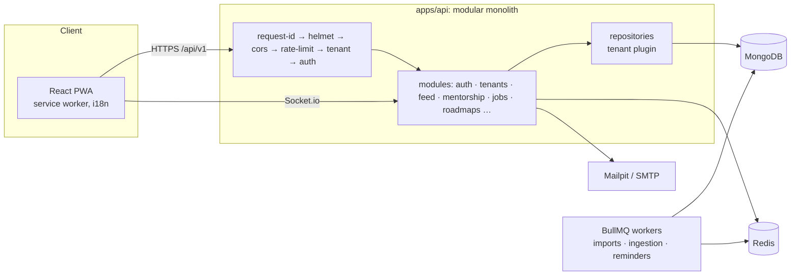

# Architecture

Phase 0 skeleton. This document grows each phase.

## Request pipeline

`route → validate (Zod) → authenticate → authorize → controller → service → repository`

## Phases

0 Foundation · 1 Secure core · 2 People · 3 Mentorship · 4 Feed and content · 5 Jobs and referrals · 6 Roadmaps and Career Galaxy · 7 Gamification, events, analytics · 8 Hardening and launch.

See `docs/adr/` for decisions.
