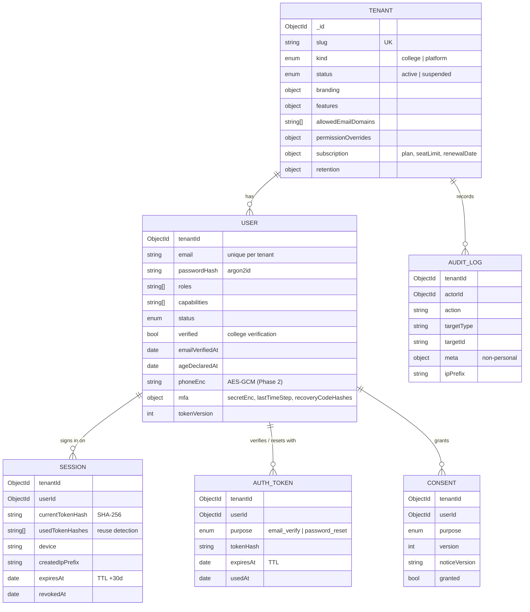

# Data model

All tenant-owned collections carry `tenantId` (stamped and filtered by the tenancy plugin), and every non-TTL index starts with `tenantId`, which is enforced by a test. Schemas use `strict: 'throw'` and timestamps.

The Tenant registry is the only platform-level collection (allowlisted in `db/models.ts`). Super admins are users of the `platform` tenant (`admin.<root>`).

The remaining collections from the spec are added by their phases: profiles and imports (2), mentorship and messaging (3), feed and content (4), jobs (5), roadmaps (6), gamification and events (7).
