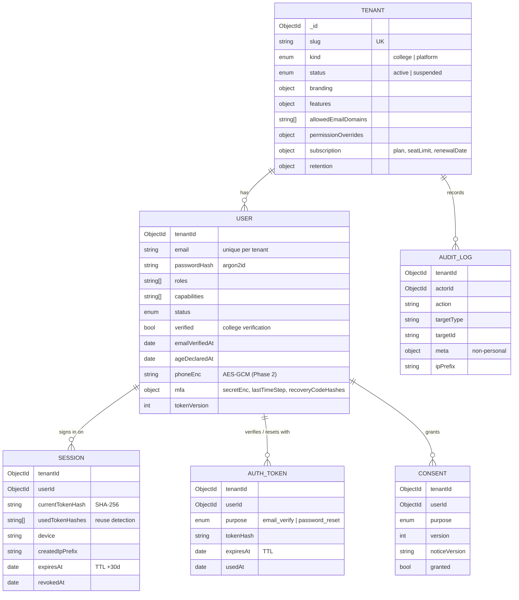
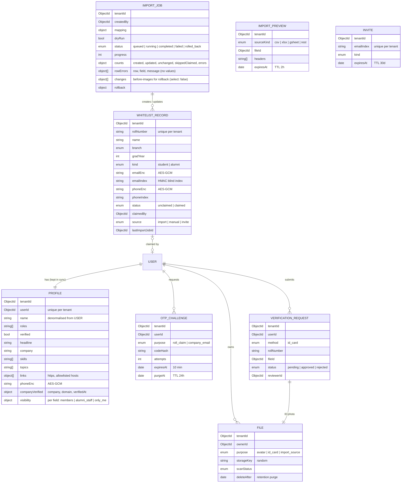

# Data model

All tenant-owned collections carry `tenantId` (stamped and filtered by the tenancy plugin), and every non-TTL index starts with `tenantId`, which is enforced by a test. Schemas use `strict: 'throw'` and timestamps.

The Tenant registry is the only platform-level collection (allowlisted in `db/models.ts`). Super admins are users of the `platform` tenant (`admin.<root>`).

## People (Phase 2)

The profile is a read model for the directory and search: `ProfilesService.sync()` copies name, roles, status and verification from the user whenever they change, and only verified, active members appear. Its `$text` index is used only through `db/search.ts`.

The remaining collections from the spec are added by their phases: mentorship and messaging (3), feed and content (4), jobs (5), roadmaps (6), gamification and events (7).
