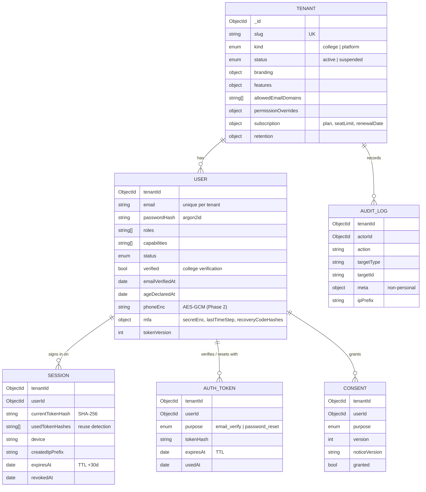
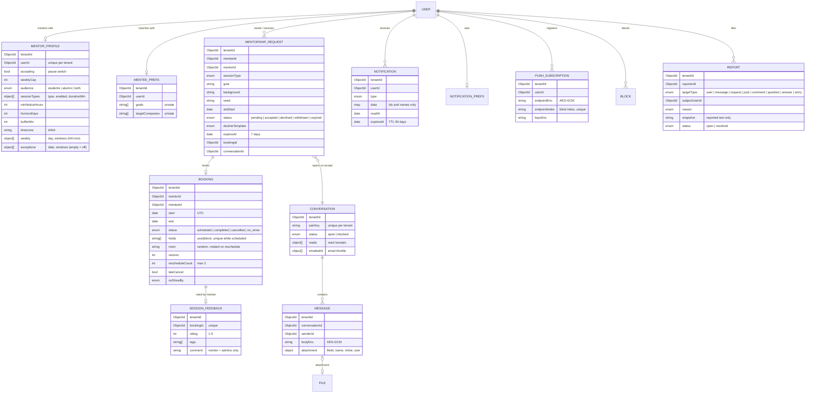
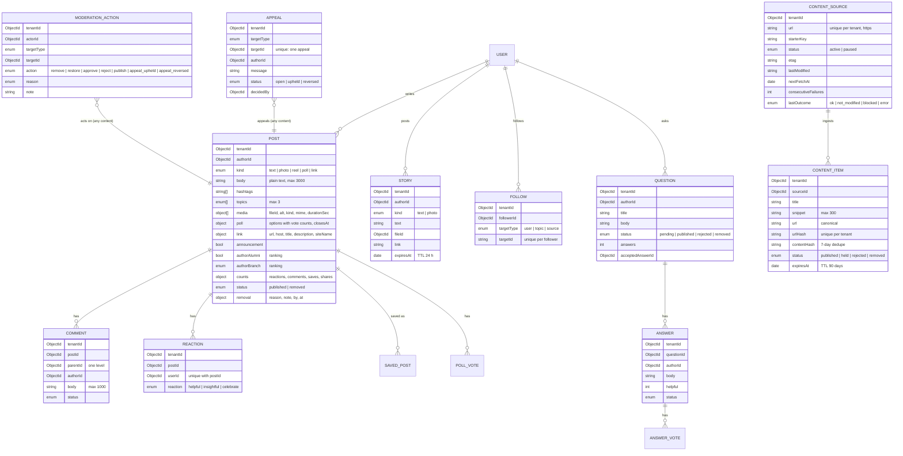
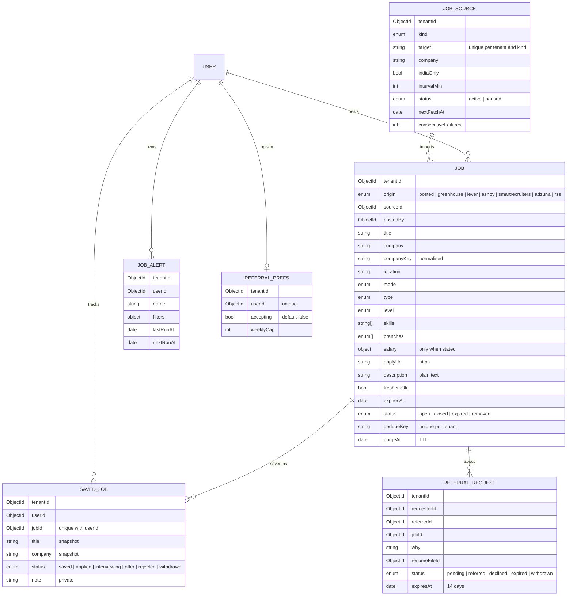
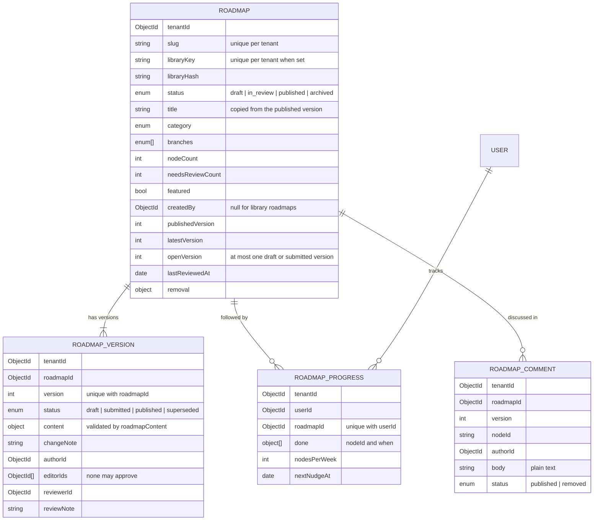
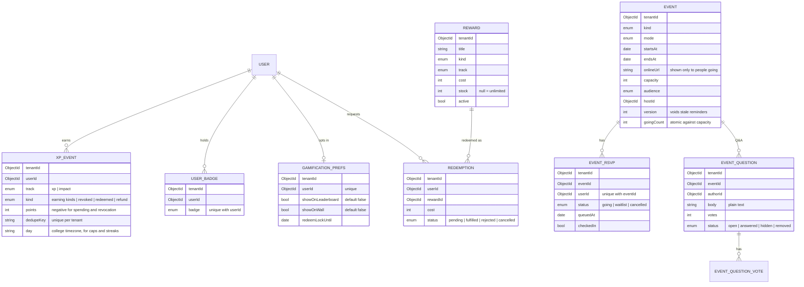
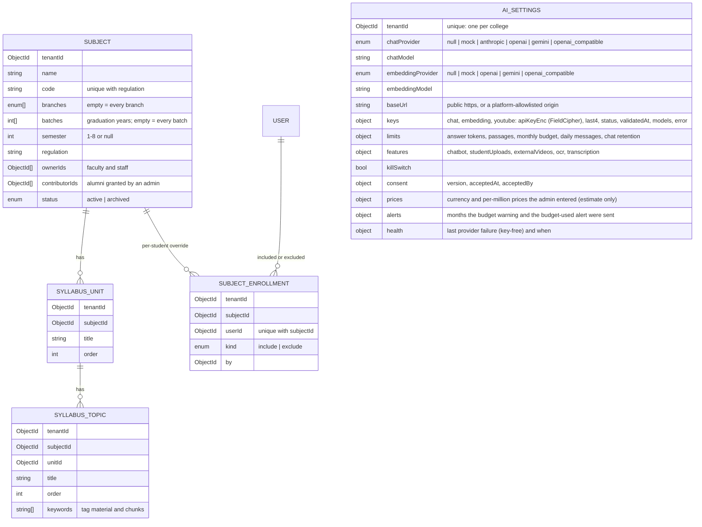
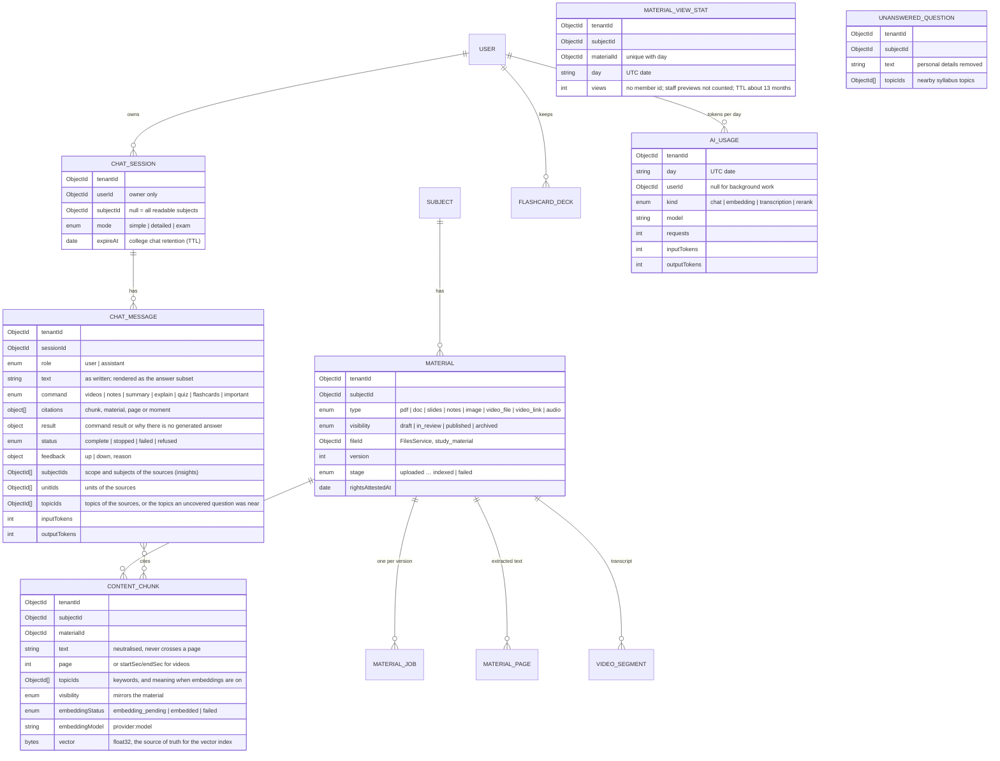

# Data model

All tenant-owned collections carry `tenantId` (stamped and filtered by the tenancy plugin), and every non-TTL index starts with `tenantId`, which is enforced by a test. Schemas use `strict: 'throw'` and timestamps.

The Tenant registry is the only platform-level collection (allowlisted in `db/models.ts`). Super admins are users of the `platform` tenant (`admin.<root>`).

## People (Phase 2)

The profile is a read model for the directory and search: `ProfilesService.sync()` copies name, roles, status and verification from the user whenever they change, and only verified, active members appear. Its `$text` index is used only through `db/search.ts`.

## Mentorship (Phase 3)

Availability is embedded in `mentorProfiles` (one document, changed atomically with the settings) rather than a separate `availability` collection. `idempotencyRecords` (TTL 24 h) store replayable responses for `Idempotency-Key`.

## Feed and content (Phase 4)

Also: `savedPosts` and `pollVotes` (unique per user and post), `answerVotes` (unique per user and answer) and `oneUsefulThings` (one staff pick per date). `moderationActions` is append-only (update and delete hooks throw). Files gain the purposes `post_media` and `story_media` with `attachedAt` (single-use claim) and `durationSec`.

## Jobs and referrals (Phase 5)

Profiles gain `companyKey` (kept in sync with `company`). Files gain the purpose `referral_resume`.

## Roadmaps (Phase 6)

## Gamification and events (Phase 7)

## Study and the AI study assistant (Phase 9)

Steps 1 to 5 of `docs/specs/ai-study-assistant.md`: subjects and settings (step 1), material and its processing (step 2), vectors and usage (step 3), the assistant's conversations (step 4), and the counters behind insights and budgets (step 5).

- **Who reads a subject:** students read the active subjects whose branch and batch rule matches their profile, plus subjects an override includes, minus ones it excludes; faculty, placement, alumni and admins read every subject of the college. One filter (`SubjectsService.readableFilter`) decides this for every route, and later for retrieval and chat.
- **Semester** is descriptive: the platform does not store a student's current semester, so the batches a subject lists are what decide who takes it.
- **Keys** are encrypted with `FieldCipher` (`keys.*.apiKeyEnc`, covered by `rotate-field-key`); only `last4` is ever returned.

### Material, passages, vectors and conversations (steps 2 to 4)

- **Vectors** are stored on the passages; Qdrant (or the in-memory store) is an index over them, filtered by college, readable subjects, model and visibility on every search.
- **Conversations** are owner-only and expire with the college's retention (TTL on `expireAt` for sessions and messages).
- **Insights** read only aggregates: answers grouped by the topics and units on them, uncovered questions grouped by topic (or by words at least 5 students used), and `materialViewStats`; every count goes through `suppress()`.

### Revamp phase 10

Tenants gain `logo.fileId` (null shows the monogram). Files gain the purpose `branding`, stored with no owner (the college's file, so erasing the uploading admin keeps it).
